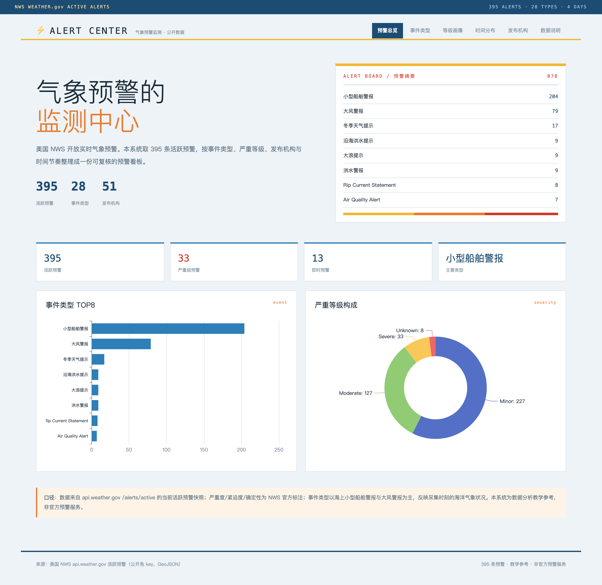
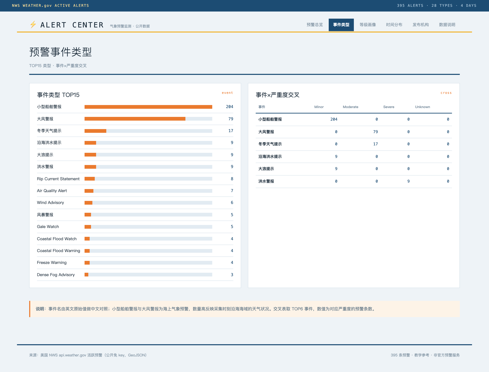
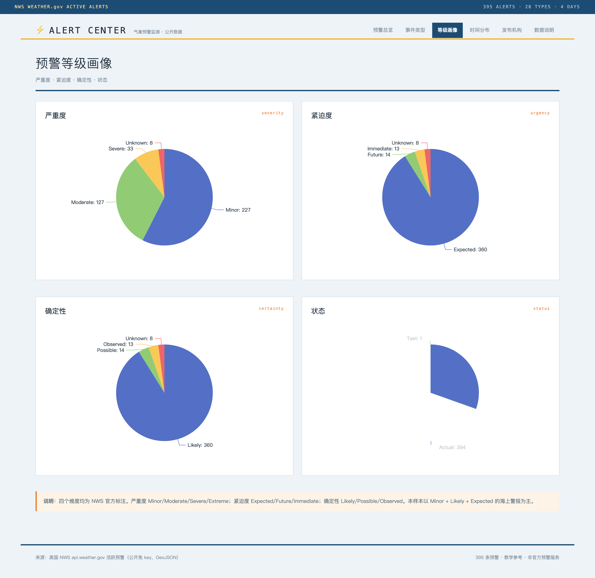
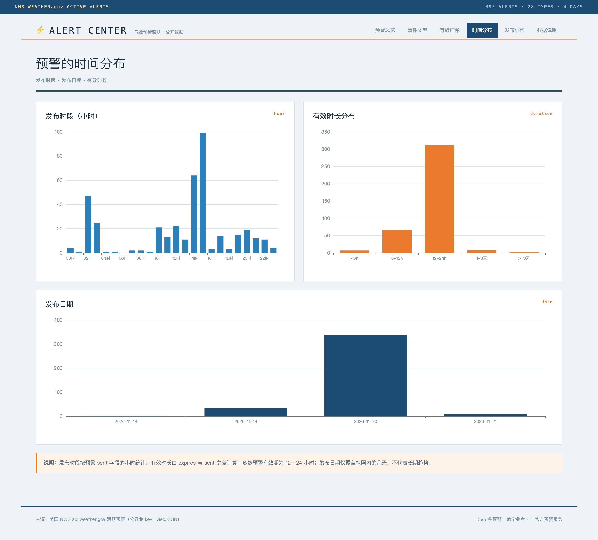
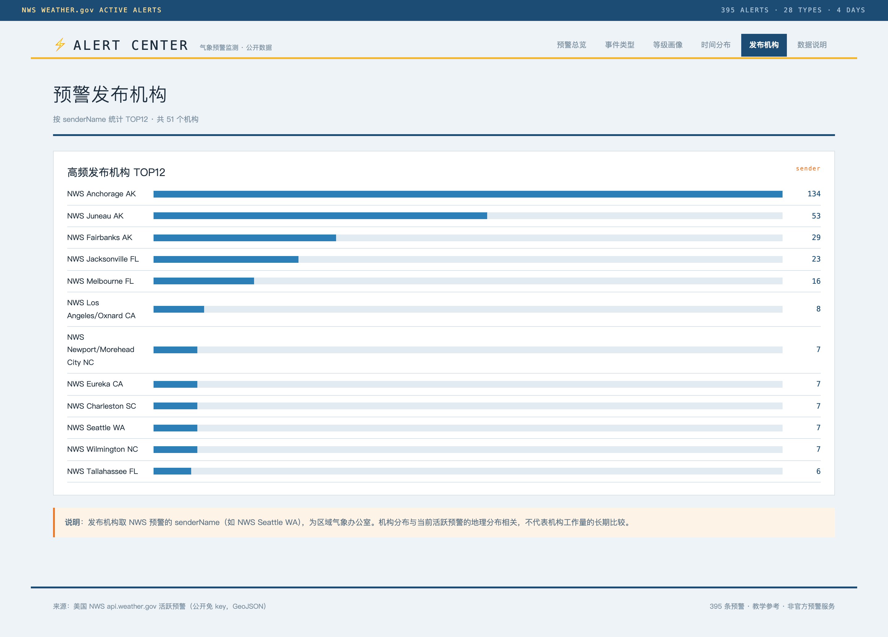
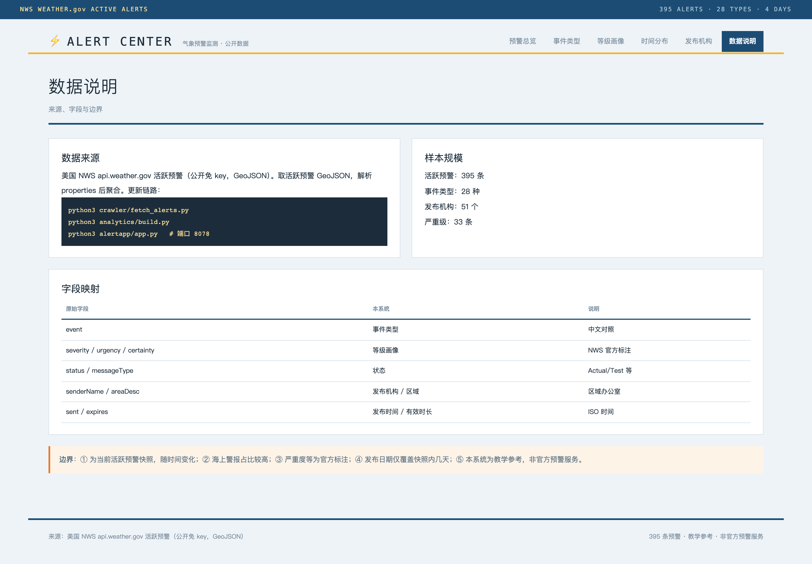

# 078 基于NOAA-Weather-gov公开数据的气象预警分析系统-设计展示

> **代码有偿获取 可接受定制 微信联系方式: csbysj2020 或 ACE2487，备注(BS)**

> **完整源码与全套文档 · 在线自助获取 >>> [https://mbd.pub/o/bread/YZaWmJpwbA==](https://mbd.pub/o/bread/YZaWmJpwbA==)**

> **成品页（功能介绍 / 更多选题）>>> [https://bishe.suilang.net/products/alert-center](https://bishe.suilang.net/products/alert-center)**

> 

> 

## 视频

> **点击查看 >>> [https://www.bilibili.com/video/BV1vYy8zMEEv/](https://www.bilibili.com/video/BV1vYy8zMEEv/)**

## 项目简介

气象预警中心风格（风暴蓝、黄橙红警示带、预警卡片），区别于事件监测台/安全档案/食谱手账。采集 NWS 公开活跃预警 395 条（28 类型、51 机构），从事件、等级、机构与时间四维分析。Flask + ECharts（本地化离线可用），6 个页面。实时快照时效与区域覆盖偏差如实标注，非官方预警服务。

气象预警是观察天气风险与应急管理的数据窗口。

本项目设计并实现了一套基于美国 NWS Weather.gov 公开数据的气象预警分析系统：通过 /alerts/active 接口获取 395 条活跃预警，解析 GeoJSON 属性字段，从事件类型、严重等级、发布机构、时间节奏与有效时长五个维度聚合分析。

系统采用 Flask + ECharts 与气象预警中心式界面（风暴蓝、黄橙红警示带、预警卡片），实现预警总览、事件类型、等级画像、时间分布、发布机构、数据说明 6 个页面。

本仓库为**设计展示**：包含项目说明、技术架构、实验结果与运行截图；完整源码、任务书、开题报告、毕业论文与使用说明可通过上方链接自助获取，成品页可查看更多选题，也可联系微信咨询定制。

## 功能特性

1. 差异化视觉：预警中心（风暴蓝/黄橙红警示带/预警卡片），非看板/画廊/监测台/档案

2. 真实采集：NWS /alerts/active 公开免 key，395 条活跃预警

3. 五维分析：事件类型/严重度/紧迫度/发布机构/有效时长

4. 等级画像：严重度、紧迫度、确定性、状态四维官方标注

5. 事件交叉：TOP6 事件 × 严重度

6. 时间节奏：发布时段、日期与有效时长分箱

7. 技术栈差异化：Flask + ECharts（本地化）

8. 合规边界：实时快照、区域覆盖偏差、非官方预警服务

## 技术架构

| 项目 | 说明 |
| --- | --- |
| 编程语言 | Python 3.8+ |
| Web 框架 | Flask（轻量路由，无 ORM） |
| 图表 | ECharts（本地化离线可用） |
| 数据源 | NWS Weather.gov（公开免 key，需 UA） |
| 样本规模 | 395 预警 / 28 类型 / 51 机构 |
| 运行端口 | http://127.0.0.1:8078 |
| 说明 | 数据直读 analysis JSON，无需数据库 |

## 目录结构

以下为完整交付版的结构（本仓库仅作设计展示）：

```
alert-center/
├── alertapp/
│   └── app.py
├── analytics/
│   └── build.py
├── crawler/
│   └── fetch_alerts.py
├── data/
│   ├── analysis/
│   │   ├── categories.json
│   │   ├── certainty.json
│   │   ├── cross.json
│   │   ├── dates.json
│   │   ├── durations.json
│   │   ├── events.json
│   │   ├── hours.json
│   │   ├── senders.json
│   │   ├── severity.json
│   │   ├── status.json
│   │   └── urgency.json
│   ├── processed/
│   │   └── alerts.csv
│   └── stats.json
├── static/
│   ├── css/
│   │   └── style.css
│   └── vendor/
│       └── echarts.min.js
├── templates/
│   ├── about.html
│   ├── agencies.html
│   ├── base.html
│   ├── events.html
│   ├── levels.html
│   ├── overview.html
│   └── time.html
├── 任务书/
│   └── 毕业设计任务书.docx
├── 开题报告/
│   └── 毕业设计开题报告.docx
├── 最终论文/
│   ├── 图/
│   │   └── fig-arch.png
│   └── …
└── …
```

## 数据与实验结论

- 实验显示样本覆盖 28 种事件类型、51 个发布机构，以小型船舶警报与大风警报为主，多数预警有效期 12—24 小时。
- 真实采集：NWS /alerts/active 公开免 key，395 条活跃预警
- 事件交叉：TOP6 事件 × 严重度

## 交付内容

1. 完整源码（Flask 应用 + 采集器 + 分析引擎 + 6 页面）
2. 真实数据（alerts.csv + analysis JSON）
3. 任务书与开题报告（Word）
4. 毕业论文（Word 七章制）
5. 二次开发说明（Word+md）
6. 6 张截图 + 封面 + 演示视频

## 常见问题

**为什么海上警报很多？**

采集时刻沿海海域预警活跃，反映当时气象状况。

**等级等同于危险程度吗？**

等级为 NWS 官方标注，不等同于用户感知风险。

**能作为预警服务吗？**

不能，本系统为教学参考，请以官方发布为准。

**图表能离线用吗？**

能，echarts.min.js 已本地化到 static/vendor/。

## 截图







